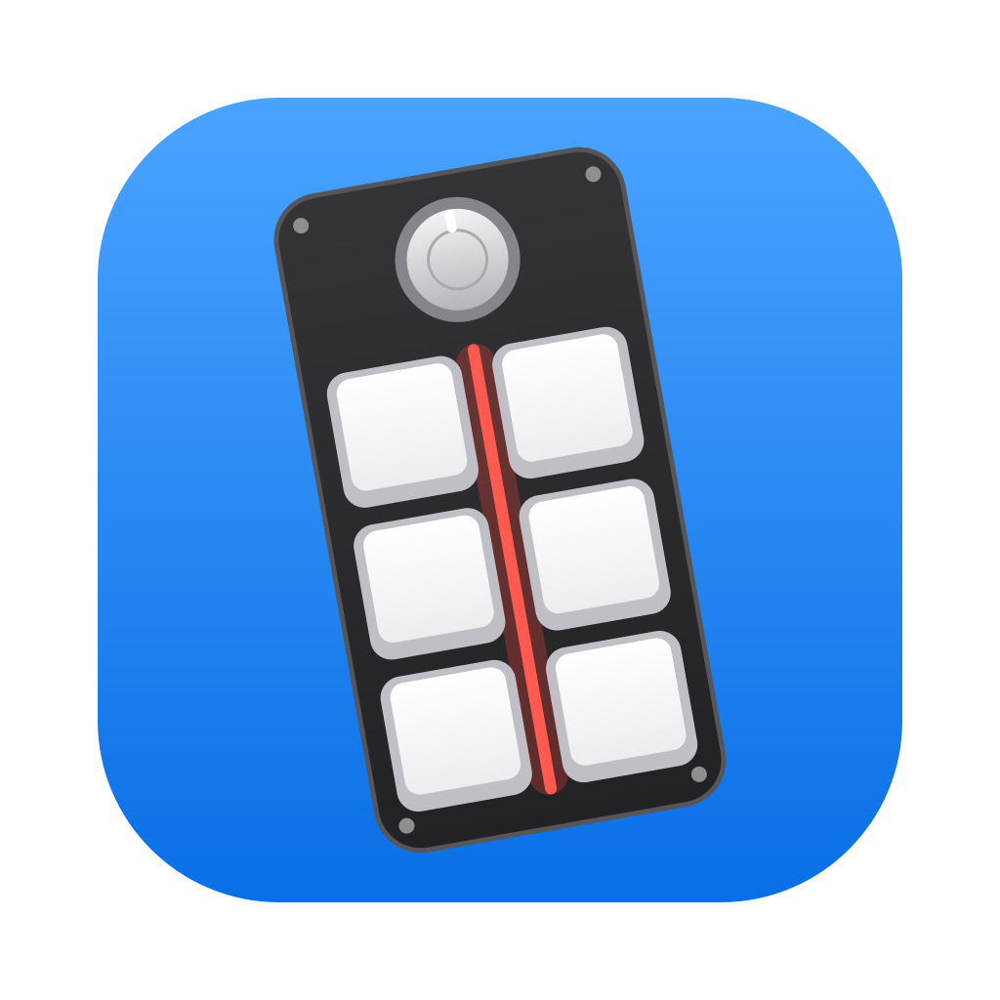
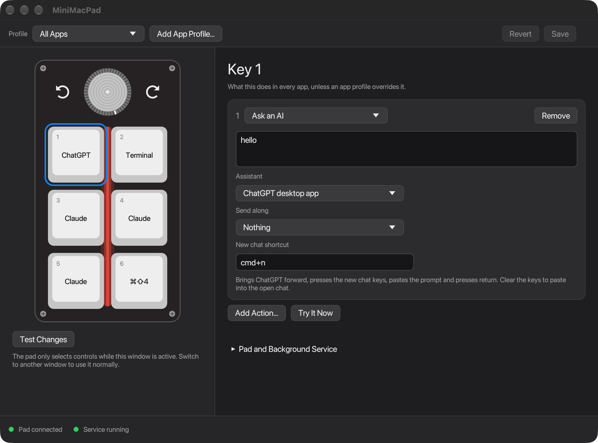

<p align="center">
  
</p>

<h3 align="center">A six-key macro pad that does what you tell it, on your Mac.</h3>

<p align="center">
  A driver and settings app for the small six-key, one-knob USB macro pads sold under many names.<br>
  Launch apps, prompt an AI, turn the volume, run scripts. A few megabytes of Rust, no account, no cloud.
</p>

<p align="center">
  <a href="#install">Install</a> ·
  <a href="#features">Features</a> ·
  <a href="#supported-pads">Supported pads</a> ·
  <a href="#the-config-file">Config file</a> ·
  <a href="https://github.com/southstar21dev/MiniMacPad/releases">Changelog</a> ·
  <a href="CONTRIBUTING.md">Contributing</a>
</p>

<p align="center">
  <a href="https://github.com/southstar21dev/MiniMacPad/releases"></a>
  <a href="https://github.com/southstar21dev/MiniMacPad/actions/workflows/ci.yml"></a>
  
  
  <a href="LICENSE"></a>
</p>

<p align="center">
  
</p>

## Features

- **Any action on any control.** Each of the six keys and the knob's turn left, turn right and press can open an app or a link, press a keyboard shortcut, change the volume, mute, show a notification or run a shell command. Stack several actions on one control and they run in order.
- **Ask an AI.** Send a prompt, with the clipboard or the selected text if you like, to Claude or Antigravity in the background and get the answer on the clipboard or pasted in place. Or have it typed into the Claude, ChatGPT, Gemini or Antigravity desktop app.
- **Per-app profiles.** A control can do something different while a particular app is in front, and fall back to its usual action everywhere else.
- **A picture of your pad.** Click a control to edit it, or press it on the pad: the key lights up in the app. While the settings window is active the pad only selects controls, unless you turn on **Test Changes** to try your edits before saving.
- **Small and quiet.** The background service is a single Rust program of under a megabyte that sleeps until you press something. The pad's keys are set to codes no app reacts to, so nothing is typed by accident.
- **Updates.** The app updates itself from GitHub releases when you say so, and only installs a download that is signed like the copy you already run.

## Supported pads

MiniMacPad is written for the pad with USB ID `1189:8890`: six keys in two columns and one clickable knob, built around a CH552 chip. It appears on AliExpress and elsewhere under many names. To check yours, open **System Information**, choose **USB**, and look for vendor ID `0x1189` and product ID `0x8890`.

Other layouts that share the chip are not supported yet.

## Install

1. Download `MiniMacPad-…-mac.zip` from [Releases](https://github.com/southstar21dev/MiniMacPad/releases), unzip it and move MiniMacPad to `/Applications`.
2. The first time, right-click it and choose **Open**, since it isn't notarized by Apple.
3. Plug in the pad. Under **Pad and Background Service**, choose **Program Pad Again** once: this stores MiniMacPad's key codes in the pad's own memory, replacing whatever was there.
4. Allow MiniMacPad under **Input Monitoring** in System Settings when asked, so it can see the pad's keys. Actions that press shortcuts or paste need **Accessibility** too.
5. Choose **Start at Login** to keep the pad working when the settings app is closed.

Requires macOS 13 or newer on Apple silicon.

## The config file

Everything the app edits lives in `~/.config/minipad/config.toml`, and you can write it by hand. Saved changes apply on the next key press.

```toml
[keys]
key1 = { open = "Safari" }
key2 = { ask = "Explain this briefly and plainly.", input = "selection" }
key3 = { ask = "Summarise this.", with = "chatgpt", input = "clipboard" }
key4 = [ { keys = "cmd+c" }, { shell = "pbpaste | wc -w | say" } ]

knob_left = { volume = -4 }
knob_right = { volume = 4 }
knob_press = { mute = true }

[apps.Safari]
knob_left = { keys = "cmd+shift+[" }
knob_right = { keys = "cmd+shift+]" }
```

Every action and option is listed in [config.example.toml](config.example.toml). There is also a command-line tool inside the app, `minipad`, to watch what the pad sends (`minipad monitor`) or program it (`minipad flash`).

## Contributing

Building from source and the repository layout are in [CONTRIBUTING.md](CONTRIBUTING.md); releases are covered in [docs/RELEASING.md](docs/RELEASING.md). To report a security problem, see [SECURITY.md](SECURITY.md).

## Acknowledgements

The pad's programming protocol was worked out by the [ch57x-keyboard-tool](https://github.com/kriomant/ch57x-keyboard-tool) project. MiniMacPad is not affiliated with the pad's manufacturer or with any of the assistants it can prompt.

## License

MiniMacPad is free software under the [GNU General Public License v3.0](LICENSE).
